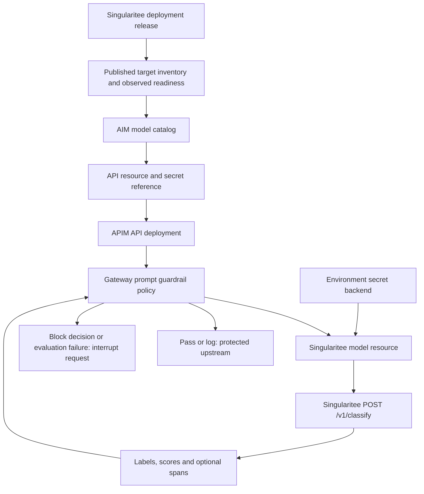

# Singularitee model resource in Agent Management

> Published deployment targets become selectable models for the Singularitee APIM resource.

## Overview

The Singularitee Gamma module owns deployment targets and immutable release definitions.
Agent Management (AIM) projects those targets into its model catalog in the same Gravitee
organization and environment. An API author selects a ready classifier, configures its
inference secret reference, and attaches the existing prompt guardrail policy. Publishing
a deployment does not attach policies or redeploy APIs.



## Key types

| Component | Contract |
| --- | --- |
| Published inventory | Namespaced bean `singularitee.publishedTargetInventoryV1`, a JDK `Function<Map<String,String>,Map<String,Object>>` |
| Catalog model | Stable deployment/target identity, release revision, task, serving binding and observed availability |
| Gateway resource | `singularitee-model`, with a selected token- or text-classification capability |
| Policy result | `ClassifierResults`: labels and scores, plus offsets for token classification |

The inventory contract carries `schemaVersion`, `complete`, `organizationId`,
`environmentId` and `targets`. Targets identify their deployment, subject/source,
model reference, task, serving endpoint, release revision, availability and whether
inference authentication is required. Credentials never cross this bridge.

## Usage

AIM reads the inventory on catalog access and resource selection/save. It reconciles
catalog records without a manual provider registration step. A complete authoritative
inventory can retire targets no longer published. A missing module or a failed or
incomplete response is not evidence that a target was removed.

Release YAML establishes membership. Fresh node observations matching the release
revision establish readiness and model task. Missing, stale or mismatched observations
cannot make a target selectable. Pipeline tasks remain unknown until their invocation
contract is established. Readiness observations do not prove gateway network access.

On save, AIM rechecks environment, task, readiness and endpoint and constructs the
serving binding on the server. Browser-supplied endpoint, model and authorization values
cannot replace that binding. The selected resource is `singularitee-model`. For example, its configuration can contain:

```json
{
  "capability": "token-classification",
  "remote": {
    "adapter": "singularitee",
    "endpoint": "https://inference.example.com",
    "modelId": "pii-classifier",
    "authorization": "Bearer {#secrets.get('/inference/credentials','token')}",
    "timeoutMs": 5000
  }
}
```

The normal API deployment mechanism carries the resource and policy to the gateway.
The resource resolves authorization on each invocation using a private copy of the
gateway-injected deployment template context. The policy uses the original
`invokeModel(PromptInput)` method. The resource owns its HTTP client lifecycle and
never starts an embedded model. Management APIs are absent from inference.
Timeouts, authentication failures, malformed results and unavailable services interrupt
policy evaluation. A detected label follows the configured block or log action.

## Options

| Resource option | Behavior |
| --- | --- |
| `remote.adapter` | `singularitee` |
| `remote.endpoint` | HTTP(S) serving base URL without user information, query or fragment |
| `remote.modelId` | Serving model identifier |
| `remote.authorization` | Optional secret-capable authorization expression |
| `remote.timeoutMs` | 1 to 60000 milliseconds; default 5000 |
| `capability` | `token-classification` or `text-classification`, derived from the selected model |

## Notes

- Deployment-owned catalog records are managed through their deployment. Catalog
  create, edit and delete operations must preserve that ownership and environment scope.
- AIM's `DR-5` catalog migration adds the nullable availability column used by deployment
  filtering. Apply it through the normal module migration process before using this integration.
- Saved API resources are explicit configuration snapshots until saved and redeployed.
  A stable serving model ID does not pin weights; immutable serving aliases would be
  required for runtime revision pinning.
- Token classification requires entity offsets. Text classification consumes label
  scores. A task name alone does not establish another vendor's wire compatibility.
- The Singularitee resource owns its HTTP client, configuration and result mapping.
  Existing classification resource plugins require no changes and are not dependencies.
  Generation, embeddings, decisions and Guardian integration are outside this increment.
- The resource uses released model API `2.2.3` and the original prompt guardrail runtime.
  The only policy change is adding `singularitee-model` to its resource picker.
  No shared model API or existing classification resource changes are required.
- Credentials use the owning deployment's environment/API secret grants, not request
  variables. Each invocation reevaluates the expression; rotation follows the Secrets
  Service's cache refresh. Missing, disabled or failed secrets are rejected before HTTP,
  including an empty token after the `Bearer` prefix. The timeout bounds secret resolution
  and HTTP together.
- Focused compatibility checks use the published guardrail `5.2.0` and model API `2.2.3`
  binaries with a controlled secret delegate. They do not prove real provider grants,
  gateway classloader wiring or live deployment. The validated policy target is APIM
  `4.13` on Java 25; older combinations are not established by these checks.
- Build/test results are not live deployment evidence. A deployment check should cover
  benign input, synthetic PII under block mode, unavailable inference and invalid
  credentials, checking that blocked requests do not reach the protected upstream.

## See also

- [Singularitee resource build and release limits](../../experiments/singularitee-model-resource/README.adoc)
- [Architecture index](README.md)
