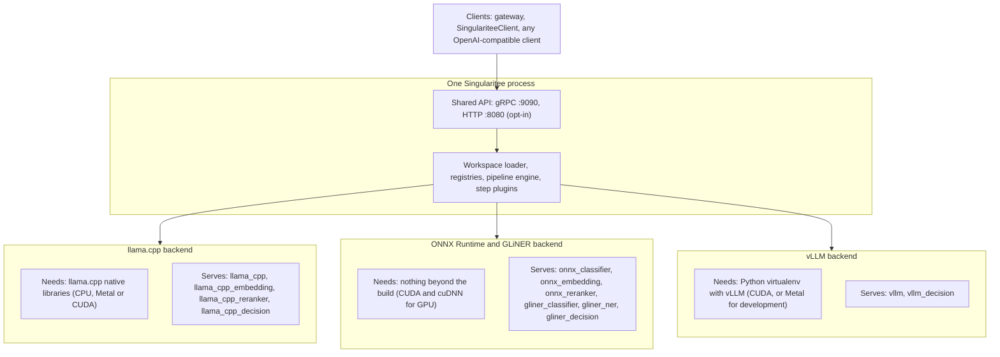
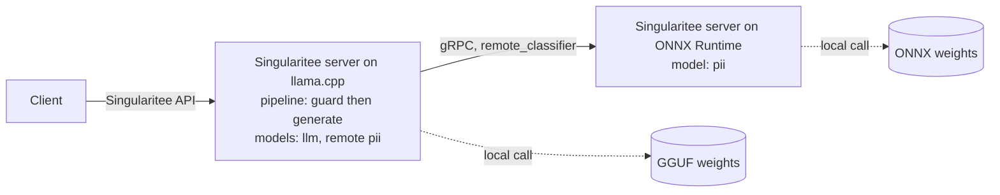

# Backend setups

> Pick a backend, build the distribution that carries it, and run it on a host or in its image: llama.cpp, ONNX Runtime with GLiNER, or vLLM.

## Overview

Every Singularitee process exposes the same API: the gRPC services and, when enabled, the
OpenAI-compatible HTTP endpoints. What differs between two processes is the backend
underneath: which engine jars the distribution carries, which native dependencies the host
or the image provides, and therefore which model types a workspace may declare.



The pipeline engine, the step plugins and the pure Java model types (`regex`,
`composite_classifier`, `llm_token_classifier`, the `remote_*` proxies) are in every
distribution. A process is meant to run one backend: each engine loads its own native
libraries, and co-locating them invites library conflicts and GPU memory contention. Several
backends are composed across processes, over gRPC, by a workspace that declares `remote:`
endpoints:



A setup is three choices, in this order:

1. The backend, from the model types the workspace needs (table below).
2. The distribution flavour: a Maven profile that selects which engine jars land in `lib/`.
3. Where it runs: on a host through `run-server.sh`, or in the image built from the matching Dockerfile.

| Backend | Model types | Distribution profile | Host dependencies | Dockerfile |
| --- | --- | --- | --- | --- |
| llama.cpp | `llama_cpp`, `llama_cpp_embedding`, `llama_cpp_reranker`, `llama_cpp_decision` | `-Pdist-llama` | llama.cpp native libraries in `~/.llama.cpp` (`install.sh`) | `Dockerfile.llamacpp-cuda` over `Dockerfile.llama-cuda` |
| ONNX Runtime, GLiNER | `onnx_classifier`, `onnx_embedding`, `onnx_reranker`, `gliner_classifier`, `gliner_ner`, `gliner_decision` | `-Pdist-onnx` (add `-Pcuda` for GPU) | none | `Dockerfile.onnx-cpu`, `Dockerfile.onnx-cuda` |
| llama.cpp with ONNX Runtime | both rows above | `-Pcuda,dist-llama-onnx` | as llama.cpp | `Dockerfile.llamacpp-cuda` |
| vLLM | `vllm`, `vllm_decision` | `-Pdist-vllm` | Python virtualenv (`scripts/setup-venv.sh`) | `Dockerfile.vllm-cuda` |
| all, for development | every type | default (no profile) | as each engine | `Dockerfile` |

## Key types

- `SingulariteeConfiguration`: registers an engine factory only when its probe class is on the classpath, which is what makes a flavour refuse another engine's model type with `Unsupported model type` instead of a `NoClassDefFoundError`.
- `src/main/assembly/distribution*.xml` (in the distribution module): one assembly descriptor per flavour, selected by the `dist-*` profiles.
- `install.sh`: downloads the pinned llama.cpp native libraries into `~/.llama.cpp` and verifies their SHA-256.
- `run-server.sh`: host launcher. Puts the llama.cpp natives on the library path and wires the vLLM virtualenv when the workspace needs one.
- `scripts/setup-venv.sh`: creates the vLLM virtualenv (`-b metal`, `-b cuda` or `-b cpu`).
- `docker/cuda/entrypoint.sh` and `docker/cuda/cuda-env.sh`: the same wiring for the CUDA images.

## Usage

Each backend below follows the same steps: build the distribution, run it on a host, build
its image, run the image. The image steps copy the distribution from
`gravitee-singularitee-standalone/gravitee-singularitee-standalone-distribution/target/distribution/`,
so the Maven build always comes first, and the last profile built is what the next
`docker build` or `run-server.sh` picks up.

### llama.cpp

Host (macOS on Apple Silicon or Linux on x86_64):

```bash
./install.sh --no-run                                       # natives into ~/.llama.cpp, then the build
./run-server.sh --workspace examples/llama/qwen3-0.6b.yaml
```

The native libraries are not in the jar. llamaj.cpp loads them from `LLAMA_CPP_LIB_PATH`
when set, then from `~/.llama.cpp`; `run-server.sh` also puts that directory on
`LD_LIBRARY_PATH`, which Linux needs to resolve the ggml backends.

CUDA image (not run on the macOS host this page was checked on). The libraries are compiled
once in a builder image, then copied into the runtime image:

```bash
mvn clean install -DskipTests -Pcuda,dist-llama
docker build -f Dockerfile.llama-cuda -t llama-cpp-cuda:local .
docker build -f Dockerfile.llamacpp-cuda --build-arg LLAMA_LIBS_IMAGE=llama-cpp-cuda:local \
  -t singularitee:llamacpp-cuda .
docker run --rm --gpus all -p 9090:9090 -p 8080:8080 \
  -v "$PWD/examples:/workspaces:ro" \
  -e GRAVITEE_AI_WORKSPACE_PATH=/workspaces/llama/qwen3-0.6b.yaml \
  -e GRAVITEE_HTTP_ENABLED=true \
  singularitee:llamacpp-cuda
```

There is no CPU-only llama.cpp Dockerfile in the repository. A CPU image is the plain
`Dockerfile` plus the release libraries; [Model images](./model-images.md#llamacpp-on-cpu)
has the recipe.

### ONNX Runtime and GLiNER

Host: nothing to install, the ONNX Runtime natives ship in its jar.

```bash
mvn clean install -DskipTests
./run-server.sh --workspace examples/classifier/pii-bert.yaml
```

CPU image (runs on `linux/amd64` and `linux/arm64`, so it also builds and runs natively on
Apple Silicon):

```bash
mvn clean install -DskipTests -Pdist-onnx
docker build -f Dockerfile.onnx-cpu -t singularitee:onnx-cpu .
docker run --rm -p 9090:9090 -p 8080:8080 \
  -v "$PWD/examples:/workspaces:ro" \
  -e GRAVITEE_AI_WORKSPACE_PATH=/workspaces/classifier/pii-bert.yaml \
  -e GRAVITEE_HTTP_ENABLED=true \
  singularitee:onnx-cpu
```

CUDA image (not run on the macOS host this page was checked on). `-Pcuda` swaps the ONNX
Runtime jar for `onnxruntime_gpu`; without it the image runs on the CPU execution provider:

```bash
mvn clean install -DskipTests -Pcuda,dist-onnx
docker build -f Dockerfile.onnx-cuda -t singularitee:onnx-cuda .
docker run --rm --gpus all -p 9090:9090 \
  -v "$PWD/examples:/workspaces:ro" \
  -e GRAVITEE_AI_WORKSPACE_PATH=/workspaces/classifier/guardrails-gliner.yaml \
  singularitee:onnx-cuda
```

### vLLM

Host: a Python virtualenv the JVM loads CPython out of. Linux with CUDA is the target;
Metal is for development.

```bash
./scripts/setup-venv.sh -b cuda          # or -b metal | -b cpu; -r adds vllm-srun for vllm_decision
mvn clean install -DskipTests
./run-server.sh --workspace examples/vllm/qwen3-0.6b.yaml
```

`run-server.sh` finds `~/.venv-gravitee-ai/.venv` and passes it as `-Dvllm4j.venv`, the only
place vLLM4j reads it from; `--venv` or `$VLLM_VENV` point elsewhere. On Apple Silicon use
the `examples/vllm/*-mac.yaml` workspaces.

CUDA image (not run on the macOS host this page was checked on). The base image already
carries CUDA, Python and vLLM, so no virtualenv is built:

```bash
mvn clean install -DskipTests -Pdist-vllm
docker build -f Dockerfile.vllm-cuda -t singularitee:vllm-cuda .
docker run --rm --gpus all -p 9090:9090 \
  -v "$PWD/examples:/workspaces:ro" \
  -e GRAVITEE_AI_WORKSPACE_PATH=/workspaces/vllm/qwen3-0.6b.yaml \
  singularitee:vllm-cuda
```

### Checking a setup

The ports bind before the models load, so wait for the catalogue rather than for the port:

```bash
until curl -sf localhost:8080/v1/models | grep -q '"id"'; do sleep 2; done
curl -s localhost:8080/v1/models | jq '.data[] | {id, type}'
```

An empty list on a server that looks healthy is a failed model load: search the log for
`failed to load`.

## Options

| Choice | Values | Effect |
| --- | --- | --- |
| Engine profile | none, `dist-onnx`, `dist-llama`, `dist-llama-onnx`, `dist-vllm` | Which engine jars the distribution carries. None carries all of them. |
| `-Pcuda` | on or off | Swaps the ONNX Runtime jar for `onnxruntime_gpu`. Applies to the whole reactor: assemble with a full `mvn clean install`, never a partial `-pl` rebuild. |
| `LLAMA_CPP_LIB_PATH` | directory | Where llamaj.cpp loads the llama.cpp libraries from. Unset, it falls back to `~/.llama.cpp`. |
| `-Dvllm4j.venv` (`VLLM4J_VENV` in the image) | directory | The virtualenv vLLM4j boots CPython from. |

Build arguments and runtime variables of the images are listed in
[Deployment](./README.md#options).

## Notes

- A workspace naming a type its flavour does not carry is refused at load with `Unsupported model type: <MODEL_TYPE_X>`. The server still starts; set `GRAVITEE_AI_WORKSPACE_STRICT=true` to fail startup instead.
- `target/distribution` holds one flavour at a time. After a `-Pdist-onnx` or `-Pcuda` build, rebuild without profiles before going back to local development, or `run-server.sh` launches the narrowed distribution.
- The llama.cpp bindings are per platform, and so is the distribution that carries them. `Class not found for runtime linux_x86_64: io.gravitee.llama.cpp.linux.x86_64.llama_h` at model load means the `llamaj.cpp` jar in `lib/` has no bindings for the platform the image runs on (a jar built locally on macOS carries only `macosx.aarch64`). Assemble the distribution with a jar that carries the Linux bindings.
- llama.cpp and llamaj.cpp are pinned together (`v0.6.0`, nightly `b11429`, with `2.11.0`); so are the vLLM image and `scripts/setup-venv.sh` (`0.31.0`). See the notes in [Deployment](./README.md#notes).
- The ONNX images also serve the GLiNER types; there is no separate GLiNER flavour.

## See also

- [Deployment](./README.md): the image reference, build arguments, runtime environment.
- [Model images](./model-images.md): baking a workspace and its weights into an image.
- [Concepts](../../concepts/README.md): which engine backs which model type.
- [Model types](../../reference/models/README.md): the config block of each type.
- [Remote and multi-server](../../guides/remote-and-multi-server/README.md): composing one process per backend.
- [Getting started](../../getting-started/README.md): the host setup in more detail.
