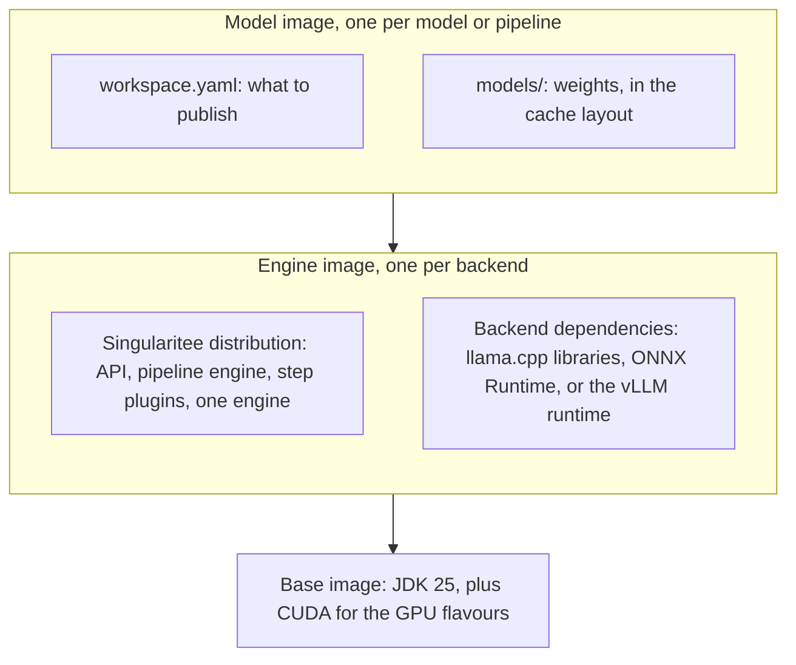
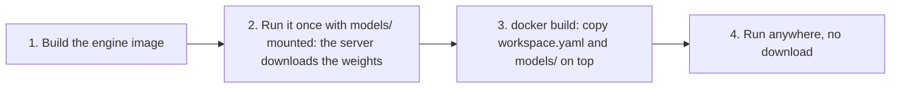

# Model images

> Turn an engine image into a self-contained one that carries its workspace and its weights: a PII classifier on ONNX Runtime, an LLM on llama.cpp, a baked vLLM model.

## Overview

The engine images built in [Backend setups](./backends.md) are generic: no workspace, no
weights. A workspace is mounted and the weights download on first start. That suits a
cluster with volumes. A model image goes one step further and bakes both in, so a container
starts in seconds, needs no access to HuggingFace and serves exactly one thing.



The recipe is the same for every backend:



Step 2 lets the server fill the cache itself instead of placing files by hand. The cache is
more than the weights: multi-file entries (a tokenizer, a GLiNER variant) carry a
`.complete-*` marker, and a directory without its marker is listed against the repository
again on the next start.

## Key types

- `GRAVITEE_AI_WORKSPACE_PATH`: the workspace the image loads; set by the model image.
- `GRAVITEE_AI_MODELS_PATH`: the model cache, `${GRAVITEEIO_HOME}/models` by default (`/opt/graviteeio-singularitee/models`).
- `GgufModelResolver`, `OnnxModelResolver`, `GlinerModelResolver`, `VllmModelResolver`: local file, then cache hit, then download. A model image makes every lookup a cache hit.
- `CacheMarker`: the `.complete-*` files that mark a multi-file cache entry as whole.

## Usage

### A PII classifier on ONNX Runtime (CPU)

Verified on Docker Desktop for Apple Silicon (`linux/arm64`); the image also builds for
`linux/amd64`.

1. Build the engine image:

```bash
mvn clean install -DskipTests -Pdist-onnx
docker build -f Dockerfile.onnx-cpu -t singularitee:onnx-cpu .
```

2. Create a build context holding the workspace, and let the engine image download the
weights into it:

```bash
mkdir -p pii-image/models
cp examples/classifier/pii-bert.yaml pii-image/workspace.yaml
cd pii-image

docker run -d --name warm --user "$(id -u):0" -p 8080:8080 \
  -v "$PWD/models:/opt/graviteeio-singularitee/models" \
  -v "$PWD/workspace.yaml:/workspace.yaml:ro" \
  -e GRAVITEE_AI_WORKSPACE_PATH=/workspace.yaml \
  -e GRAVITEE_HTTP_ENABLED=true \
  singularitee:onnx-cpu

until curl -sf localhost:8080/v1/models | grep -q '"pii"'; do sleep 2; done
docker rm -f warm
```

`--user "$(id -u):0"` makes the container write the mounted folder as you; the images accept
any uid in group `root`. `models/` now holds the cache (110 MB here):

```
models/gravitee-io/bert-small-pii-detection/
├── .complete-tokenizer
├── config.json
├── model.onnx
├── special_tokens_map.json
├── tokenizer.json
├── tokenizer_config.json
└── vocab.txt
```

3. Write `pii-image/Dockerfile`:

```dockerfile
ARG BASE_IMAGE=singularitee:onnx-cpu
FROM ${BASE_IMAGE}

# The workspace is code: root-owned, read-only. The cache stays writable by the runtime user.
COPY --chown=root:root workspace.yaml ${GRAVITEEIO_HOME}/workspace.yaml
COPY --chown=graviteeio:root models/ ${GRAVITEEIO_HOME}/models/

ENV GRAVITEE_AI_WORKSPACE_PATH=${GRAVITEEIO_HOME}/workspace.yaml \
    GRAVITEE_AI_WORKSPACE_STRICT=true \
    GRAVITEE_HTTP_ENABLED=true
EXPOSE 8080
```

`GRAVITEEIO_HOME`, the user and the entrypoint are inherited from the engine image.
`GRAVITEE_AI_WORKSPACE_STRICT=true` makes a model that fails to load fail the container
instead of leaving a healthy server with an empty catalogue.

4. Build and call it:

```bash
docker build -t singularitee-pii:local .
docker run --rm -p 9090:9090 -p 8080:8080 singularitee-pii:local

curl -s localhost:8080/v1/classify -H 'content-type: application/json' \
  -d '{"model":"pii","input":"My email is john@example.com"}' | jq '.results[0].scores | keys'
# ["B-EMAIL_ADDRESS", "I-EMAIL_ADDRESS", "O"]
```

The model is published about a second after the JVM is up. The log shows the cache hits:

```
OnnxModelResolver - ONNX file already cached: /opt/graviteeio-singularitee/models/gravitee-io/bert-small-pii-detection/model.onnx
OnnxModelResolver - Tokenizer already cached: /opt/graviteeio-singularitee/models/gravitee-io/bert-small-pii-detection
ModelRegistry - Model published: id=pii, name=gravitee-io/bert-small-pii-detection, type=CLASSIFIER, visible=true
```

To prove the image is self-contained, start it on a network with no route out and look for
the same lines:

```bash
docker network create --internal isolated
docker run --rm --network isolated singularitee-pii:local
```

The same four steps package any workspace of the ONNX backend: swap `pii-bert.yaml` for
`pii-gliner.yaml` (zero-shot, 42 entity types), an embedder or a reranker. On a GPU host use
`singularitee:onnx-cuda` as `BASE_IMAGE` and add `--gpus all` to both `docker run` commands.

### llama.cpp on CUDA

Same recipe over `singularitee:llamacpp-cuda` (see [Backend setups](./backends.md#llamacpp)).
Not run on the macOS host this page was checked on.

```bash
mkdir -p qwen-image/models
cp examples/llama/qwen3-0.6b.yaml qwen-image/workspace.yaml
cd qwen-image

docker run -d --name warm --gpus all --user "$(id -u):0" -p 8080:8080 \
  -v "$PWD/models:/opt/graviteeio-singularitee/models" \
  -v "$PWD/workspace.yaml:/workspace.yaml:ro" \
  -e GRAVITEE_AI_WORKSPACE_PATH=/workspace.yaml \
  -e GRAVITEE_HTTP_ENABLED=true \
  -e HF_TOKEN \
  singularitee:llamacpp-cuda

until curl -sf localhost:8080/v1/models | grep -q '"agent"'; do sleep 2; done
docker rm -f warm
```

The Dockerfile is the one from the PII example with
`ARG BASE_IMAGE=singularitee:llamacpp-cuda`. A GGUF cache entry is a single file,
`models/Qwen/Qwen3-0.6B-GGUF/Qwen3-0.6B-Q8_0.gguf`, so it can also be placed by hand: the
path is `models/<repo>/<file>`, with `<repo>` the model's `name` and `<file>` its
`llama_cpp.path`.

```bash
docker build -t singularitee-qwen:local .
docker run --rm --gpus all -p 9090:9090 -p 8080:8080 singularitee-qwen:local

curl -s localhost:8080/v1/chat/completions -H 'content-type: application/json' \
  -d '{"model":"agent","messages":[{"role":"user","content":"Say hello in five words."}]}' | jq
```

Call the pipeline id (`agent`), not the raw model id (`llm`): the reasoning and tool tags
are handled by the pipeline step.

### llama.cpp on CPU

The repository has no CPU llama.cpp Dockerfile: the plain `Dockerfile` carries the llama.cpp
jars but not the native libraries, which are never in the jar. Add the pinned release
libraries on top of it, the way `install.sh` does on a host. `linux/amd64` only: llamaj.cpp
has no `linux/arm64` bindings.

```bash
mvn clean install -DskipTests -Pdist-llama
docker build --platform linux/amd64 -f Dockerfile -t singularitee:llama-base .
```

`Dockerfile.llama-cpu`, in a folder of its own:

```dockerfile
ARG BASE_IMAGE=singularitee:llama-base

FROM debian:bookworm-slim AS llama-natives
# Keep both in step with install.sh (LLAMA_CPP_VERSION, LLAMA_CPP_SHA256_ubuntu_x64).
ARG LLAMA_CPP_VERSION=b12359
ARG LLAMA_CPP_SHA256=0bc1f091e8916102b6d8f2cf944233a620e90a0f856c72d0ce41150c65c2e72e
RUN apt-get update && apt-get install --yes --no-install-recommends curl ca-certificates && \
    rm -rf /var/lib/apt/lists/*
# The loader expects the libraries flat, without llama.cpp's own tool implementations.
RUN set -eux; \
    curl -fsSL -o /tmp/llama.tar.gz \
      "https://github.com/ggml-org/llama.cpp/releases/download/${LLAMA_CPP_VERSION}/llama-${LLAMA_CPP_VERSION}-bin-ubuntu-x64.tar.gz"; \
    echo "${LLAMA_CPP_SHA256}  /tmp/llama.tar.gz" | sha256sum -c -; \
    mkdir /extract /llama-libs; \
    tar -xzf /tmp/llama.tar.gz -C /extract; \
    find /extract \( -type f -o -type l \) \( -name '*.so' -o -name '*.so.*' \) -exec cp -P {} /llama-libs/ \; ; \
    find /llama-libs \( -name '*-common*' -o -name '*-impl*' \) -delete

FROM ${BASE_IMAGE}
USER root
# libgomp1: OpenMP runtime the CPU ggml backends link against.
RUN apt-get update && apt-get install --yes --no-install-recommends libgomp1 && \
    apt-get clean && rm -rf /var/lib/apt/lists/*
ENV LLAMA_CPP_LIB_PATH=${GRAVITEEIO_HOME}/native/llama-cpu
COPY --from=llama-natives --chown=root:root /llama-libs/ ${LLAMA_CPP_LIB_PATH}/
# The ggml backends are opened by name from this directory.
ENV LD_LIBRARY_PATH=${LLAMA_CPP_LIB_PATH}
USER graviteeio
```

```bash
docker build --platform linux/amd64 -f Dockerfile.llama-cpu -t singularitee:llama-cpu .
```

`singularitee:llama-cpu` is then an engine image like the others: mount a workspace, or use
it as `BASE_IMAGE` of a model image as above.

Checked here as far as an Apple Silicon host allows: the image builds, the checksum
verifies, the server boots and downloads the GGUF. The model load itself was not exercised,
because the distribution assembled on that host carried macOS-only llama.cpp bindings (see
the note on `Class not found for runtime linux_x86_64` in
[Backend setups](./backends.md#notes)). Validate on a Linux x86_64 build before relying on it.

### vLLM

`Dockerfile.vllm-cuda` has the bake built in, because vLLM checkpoints are large and the
base image already has the HuggingFace client. No warm-up run is needed:

```bash
mvn clean install -DskipTests -Pdist-vllm
HF_TOKEN=hf_xxx docker build -f Dockerfile.vllm-cuda \
  --secret id=hf_token,env=HF_TOKEN \
  --build-arg BAKE_MODEL=openai/gpt-oss-20b \
  --build-arg BAKE_WORKSPACE=vllm/gpt-oss-20b.yaml \
  -t singularitee:gpt-oss-20b .
```

`BAKE_WORKSPACE` is a path under `examples/`; it is copied to
`${GRAVITEEIO_HOME}/workspace.yaml`, which the CUDA entrypoint loads when
`GRAVITEE_AI_WORKSPACE_PATH` is unset. The token travels as a BuildKit secret, never a build
argument. Not run on the macOS host this page was checked on.

## Options

| Setting | Where | Purpose |
| --- | --- | --- |
| `BASE_IMAGE` | model image build argument | The engine image to package on: `singularitee:onnx-cpu`, `singularitee:onnx-cuda`, `singularitee:llamacpp-cuda`, `singularitee:llama-cpu`. |
| `GRAVITEE_AI_WORKSPACE_PATH` | model image `ENV` | The baked workspace. An explicit `-e` at run time still wins, so the image also takes a mounted workspace. |
| `GRAVITEE_AI_WORKSPACE_STRICT` | model image `ENV` | `true`: a model or pipeline that fails to load fails startup. |
| `GRAVITEE_HTTP_ENABLED` | model image `ENV` | `true` when the image serves the OpenAI-compatible API on `8080`. |
| `HF_TOKEN` | warm-up run only | Gated repos and faster downloads. Passed with `-e` to the warm-up container, so it never reaches an image layer. |
| `LLAMA_CPP_VERSION`, `LLAMA_CPP_SHA256` | `Dockerfile.llama-cpu` build arguments | The llama.cpp release and its checksum. Must match the llamaj.cpp binding. |
| `BAKE_MODEL`, `BAKE_WORKSPACE` | `Dockerfile.vllm-cuda` build arguments | The vLLM bake; see [Deployment](./README.md#build-arguments). |

## Notes

- One model image per model, or per pipeline with its models. Compose several with a client workspace and `remote_*` models rather than growing one image; see [Remote and multi-server](../../guides/remote-and-multi-server/README.md).
- Tag a model image on what it contains (engine version, model, quantisation), not only on the code version: the weights layer is the large one and changes on its own schedule.
- The weights layer sits on top of the engine layers, so a new engine image pushes the weights again. When that matters, publish the weights as an image of their own and `COPY --from` it.
- A baked workspace with `includes:` needs its sibling `models/`, `pipelines/` and `templates/` folders copied next to it. Put them in a folder of their own (for example `${GRAVITEEIO_HOME}/workspace/`) so the workspace's `models/` does not collide with the weights cache.
- Do not start a container with `--network none` to test for downloads: the node needs a network interface to start. Use an `--internal` network.
- The warm-up container serves real traffic. Send it a request before stopping it and the model image is tested before it is built.
- Weights carry their own licences. Baking them into an image redistributes them.
- A model image inherits the engine image's defaults: gRPC and HTTP bind `0.0.0.0` with authentication off. Set `GRAVITEE_GRPC_AUTH_*` or `GRAVITEE_HTTP_AUTH_*` at run time, never in the image.

## See also

- [Backend setups](./backends.md): building each engine image.
- [Deployment](./README.md): build arguments, runtime environment, image hardening.
- [Workspaces](../../workspaces/README.md): the YAML the image bakes in.
- [Configuration](../../reference/configuration.md): `ai.workspace.strict`, `ai.models.path`, the download keys.
- [Validated models](../models/README.md): models run end to end, with sizes.
- [Guards and redaction](../../guides/guards-and-redaction/README.md): using the PII model as a guard in a pipeline.
